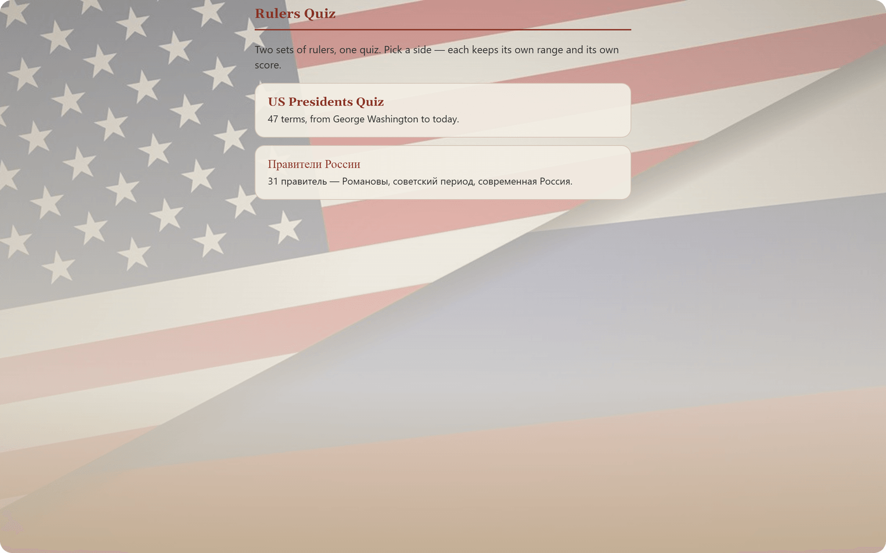
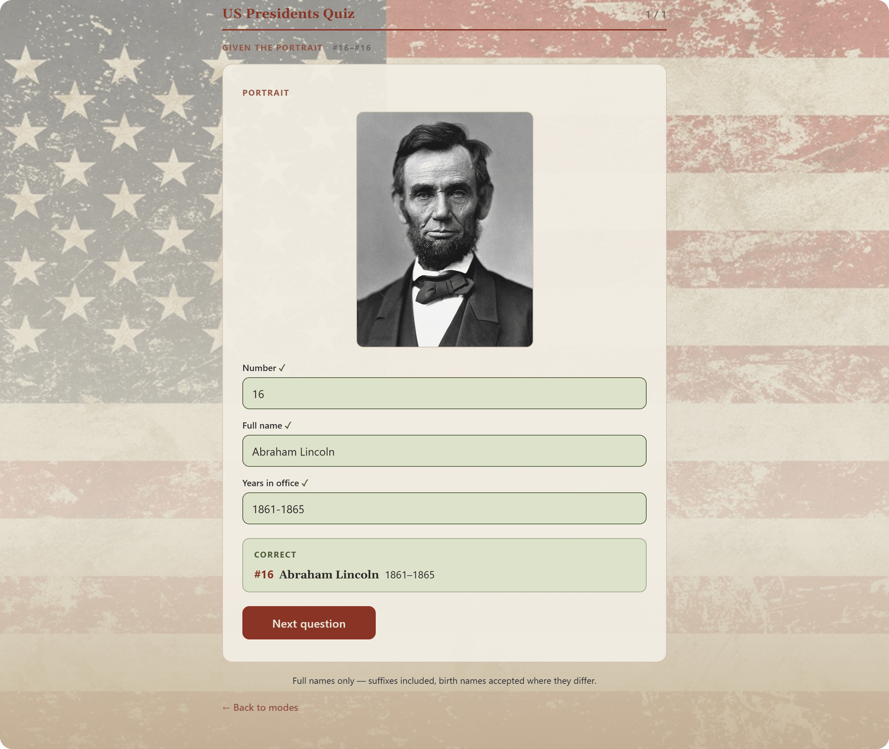
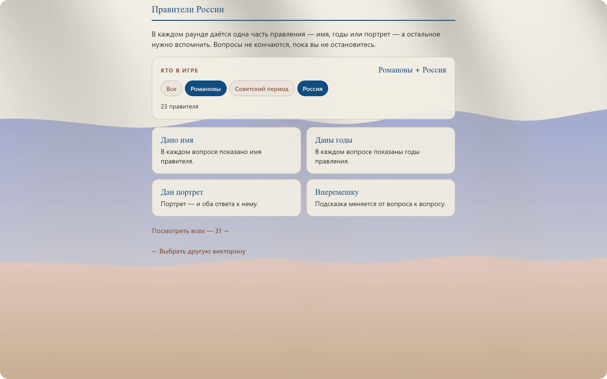
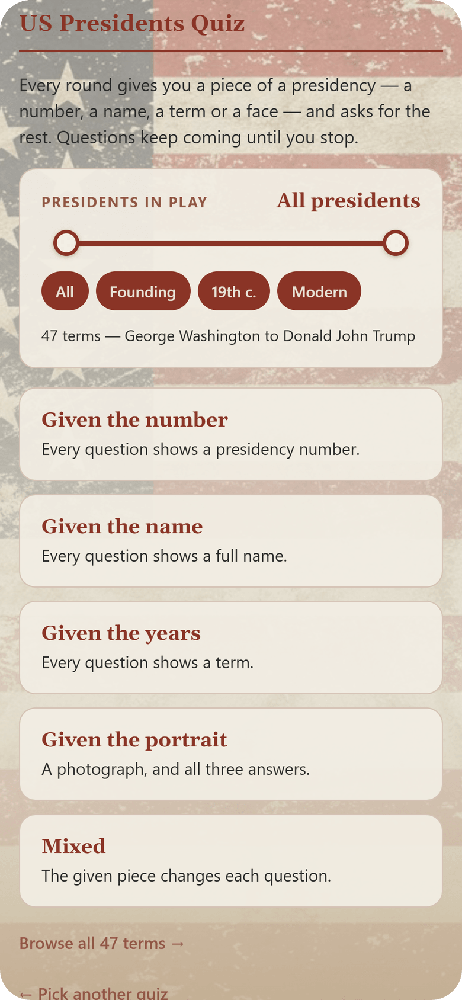
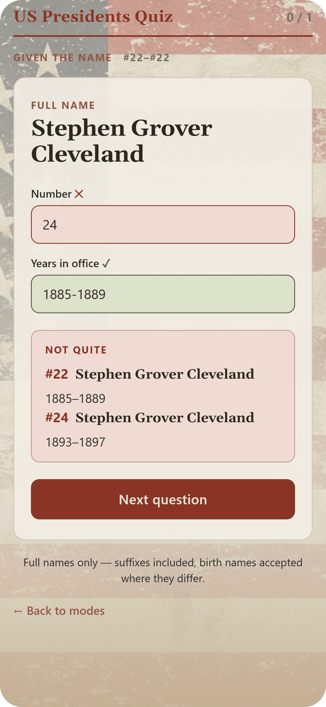
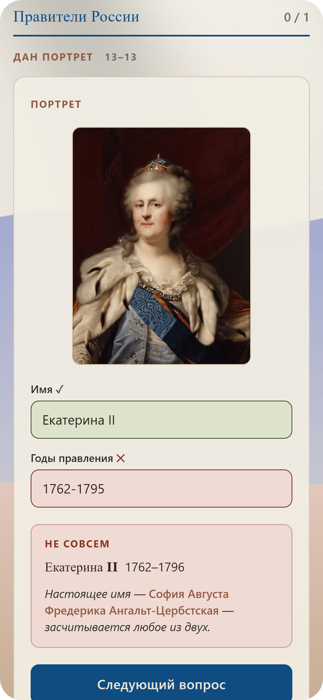
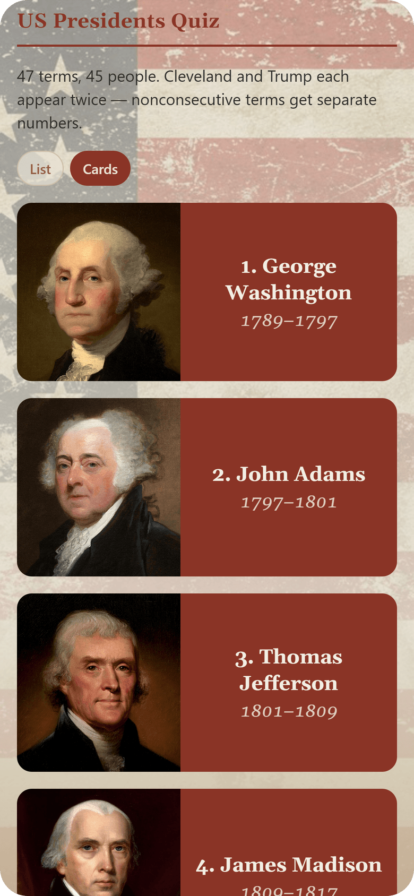
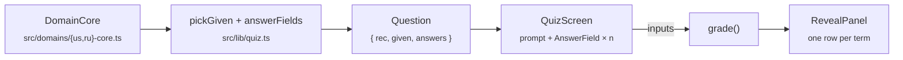

<div align="center">


# Rulers Quiz

**Put a name to a portrait, a number to a name, years to a reign, or any other pairing.**<br/>
47 US presidential terms in English and 31 Russian rulers in Russian, on one quiz engine.

[](https://rulers-quiz.vercel.app/)

[](https://docs.expo.dev/versions/v57.0.0/)
[](https://reactnative.dev/)
[](https://docs.expo.dev/router/introduction/)
[](https://www.typescriptlang.org/)
[](#building--deploying)
[](tests/grading.test.ts)

<br/>
https://github.com/user-attachments/assets/4868459c-415d-4b8a-a999-10c31e7e71a9
<br/>




</div>

---

## Two quizzes, one engine

<table>
  <tr>
    <th width="50%">🇺🇸 US Presidents · <code>/us</code></th>
    <th width="50%">🇷🇺 Правители России · <code>/ru</code></th>
  </tr>
  <tr>
    <td></td>
    <td></td>
  </tr>
  <tr>
    <td>47 terms, Washington to Trump, in English. A slider picks any run of presidencies, and the chips are shortcuts into it.</td>
    <td>31 rulers, from the first Romanov to the present day, in Russian. Era chips toggle as a set, so «Романовы + Россия» is a valid pool.</td>
  </tr>
</table>

Both domains share every screen, component and grading rule. Each one is a registry of fields,
modes, strings and an accent colour, and nothing in the UI names a language or a mode.

## On your phone

Android comes first; the web build works just as well in a mobile browser.

<table>
  <tr>
    <td align="center"></td>
    <td align="center"></td>
    <td align="center"></td>
    <td align="center"></td>
  </tr>
  <tr>
    <td align="center"><sub><b>Pick a range and a mode</b></sub></td>
    <td align="center"><sub><b>Two terms, one reveal</b></sub></td>
    <td align="center"><sub><b>Birth names count</b></sub></td>
    <td align="center"><sub><b>Browse every face</b></sub></td>
  </tr>
</table>

## Features

- **Five ways to play.** You get one piece of a reign and supply the rest. The piece can be the
  presidency number, the name, the years, a portrait, or a mix that changes every question.
  `/ru` has no numbers, so it offers four modes.
- **Your own pool.** Narrow the quiz to the Founders, the 19th century, the Soviet period, or
  any run you drag out on the slider. Your choice is remembered per quiz and can be shared as
  `?range=1-19,28-31`.
- **A gallery.** Every ruler is listed as a row or as a portrait card.
- **Strict, fair grading:**
  - **Repeat holders.** Cleveland (#22/#24), Trump (#45/#47) and Putin each hold two terms.
    Given the name, either term counts and the reveal lists both. A number from one term with
    the years of the other is wrong.
  - **Ongoing terms** accept `present` / «н. в.», the bare start year, or the scheduled end.
  - **Suffixes and numerals are required.** `Barack Hussein Obama` isn't #44, and Николай I
    isn't Николай II.
  - **Birth names and aliases.** Hiram Ulysses Grant, Lenin's and Stalin's real names, and
    Catherine the Great's Sophie of Anhalt-Zerbst are all accepted.
  - **Unicode-aware matching** folds case, punctuation and `ё` → `е`.
- **Mobile keyboards that work.** The years field gets a keyboard on every platform where
  `1762-1796` can actually be typed.

## How it works



A **mode names the prompt**. `pickGiven` resolves it (`mixed` picks a different given piece
each time), and `answerFields` asks for every other field in the domain's order. Each field's
`FieldSpec` carries its label, placeholder, keyboard, how to show it and how to check it, so
`QuizScreen` just renders `q.answers.map(...)`. `grade` scores each candidate term as a whole
and keeps the best one, which is how the two-row Cleveland reveal happens without any special
case.

The grading logic in `src/lib/` and `src/domains/*-core.ts` imports no React Native values,
so the whole suite runs on bare Node with no test framework.

## Getting started

```bash
git clone https://github.com/l4nzel0d/US-Presidents-Quiz-App.git
cd US-Presidents-Quiz-App
npm install

npm run web        # run in the browser
npm start          # dev server for Android (needs a dev client, see below)
npm test           # 127 grading assertions over both domains
npx tsc --noEmit   # typecheck
```

> [!NOTE]
> **Expo Go won't work.** The app links `react-native-keyboard-controller`, a native module, so
> on a device you need a development build (`expo-dev-client` is already a dependency):
> `eas build --profile development`, install it, then `npm start`.

## Project structure

```
src/
├── app/          Expo Router routes: thin wrappers only
│   ├── index     the chooser
│   ├── us/       _layout · index (menu) · list · quiz/[mode]
│   └── ru/       same shape
├── screens/      MenuScreen · ListScreen · QuizScreen, shared by both domains
├── lib/          pure logic: domain vocabulary, quiz, grading, ranges, storage
├── domains/      us-core / ru-core (pure, tested) + us / ru (adds images)
├── data/         us-presidents.ts (47) · ru-rulers.ts (31)
├── components/   UI pieces + portrait maps
├── state/        DomainContext · RangeContext
└── theme/        a translation of .legacy/styles.css
tests/            grading.test.ts + a tiny Node resolver hook
.legacy/          the original vanilla-JS web app this was ported from
```

## Building & deploying

**Android APK** (arm64-v8a) via EAS:

```bash
eas build --profile preview
```

**Web**: a static export, hosted on Vercel:

```bash
npx expo export --platform web   # writes dist/
```

Static rendering emits the dynamic quiz routes as literal `dist/us/quiz/[mode].html` and
`dist/ru/quiz/[mode].html`, so `vercel.json` rewrites `/us/quiz/:mode` and `/ru/quiz/:mode`
onto them. Any other static host needs the same two rewrites.

## Contributing

Read [`AGENTS.md`](AGENTS.md) before you touch anything. It covers the architecture, the
grading rules worth keeping, and the pitfalls that have already bitten once: typed-route
poisoning, accent colours that can't live in a `StyleSheet`, the twin-thumb slider. Run
`npm test` after any change to `src/lib/` or `src/domains/`.
